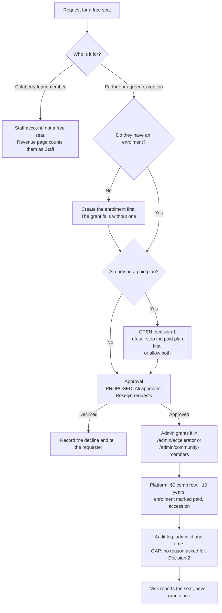
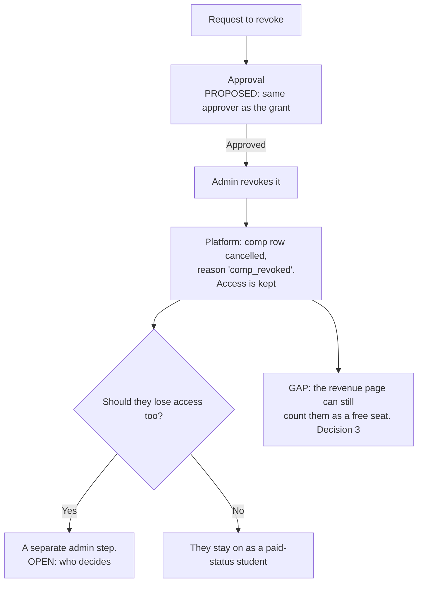

# Granting and revoking a free seat: the decision, step by step

**For:** Roselyn (sales owner) and Ali (approver), to review and correct.
**Status:** draft outline. It shows how a free seat (a "comp") is granted and revoked today, where the gaps are, and the points a decision has to fill. **Nothing here is policy yet.** Each step marked *proposed* or *open* waits on Roselyn and Ali. It goes with [COMPS_FOR_ROSELYN.md](COMPS_FOR_ROSELYN.md); the four decisions referred to below are numbered as in that file.

Platform references are to commit `109820a`.

## Granting a free seat

What the platform does when an admin grants a seat:
- It creates an active comp row at $0 that runs for 3,650 days (`subscriptionService.ts:645-669`).
- It marks the enrolment paid, active and portal-enabled, with $0 paid (`:596-602`).
- If the person already has an active comp, it reuses that one.

What it does **not** do:
- Ask for approval: any admin login can grant a seat (`acceleratorRoutes.ts:91`).
- Ask why. The admin audit log records which admin made the request and when, but not a reason (`auditMiddleware.ts:77-84`).
- Check whether the person is already on a paid plan.

## Revoking a free seat

When a seat is revoked, the platform cancels every active comp row across the person's enrolments (`subscriptionService.ts:683-689`). It doesn't touch their access, by design, so a revoke can never lock out someone who is actually paying (`:678-681`).

## What to record for each seat

The platform already keeps some of these fields; the rest would have to be added. Decision 2 settles whether they go on the grant itself or into a log kept somewhere else.

| Data point | Why it's needed | Stored today? |
|---|---|---|
| Enrolment id and holder | Who has the seat | Yes (`enrollment_id`; the name is on the enrolment) |
| Start date | Since when | Yes (`started_at`) |
| Category: staff, partner, or agreed exception | The outcome names these three groups, and staff are counted differently | No |
| Reason, in a sentence | Why this person, so it can be reviewed later | No |
| Requested by | Who asked | No |
| Approved by, and when | Shows the decision was made by a person | No |
| Granted by (the admin who clicked) | Accountability for the change | Yes, in `audit_logs`: an admin id and a time. But the entry reads as `create` on `enrollments`, and for a staff login the id is an enrolment id |
| Paid plan held at the time of the grant (plan and row) | Decision 1, and so a grant can't quietly hide revenue | No: only visible by comparing rows afterwards |
| Review date (*proposed*) | A seat never lapses on its own, so someone has to look at it again | No |
| Revoked by, when, and why | The same accountability on the way out | Partly: who and when are in `audit_logs` (as `delete` on `enrollments`); the subscription row has the date and a fixed `comp_revoked` reason |
| Whether access was also removed | Revoking doesn't remove access | No: it's a separate step with nothing linking the two |

## Gaps this outline shows

1. **No approval step.** Any admin can grant a seat. The story says the decision belongs to a person, but the platform doesn't say which person.
2. **No reason is recorded.** Who granted a seat and when are in the audit log, but nobody is asked why. This is decision 2, and [COMP_AUDIT_PROPOSAL.md](COMP_AUDIT_PROPOSAL.md) proposes a fix. Until then, Vick reports "why" as unknown for every seat.
3. **No rule for someone who is already paying.** This is decision 1, and it's the one that can take real revenue off the revenue page.
4. **Revocation is split across two steps.** The seat comes off in one, access in another, and nothing ties them together. Decision 3 covers how the revenue page counts it in the meantime.
5. **No review date.** A seat runs for about ten years unless someone remembers to revoke it.
6. **Free seats count as "paid"** wherever enrolments are counted, including the payment pre-flight list. This is decision 4.

## Questions for Roselyn and Ali

- Is this the right flow? In particular: who approves a grant, and does the same person approve a revoke?
- Are staff, partner and agreed exception the full list of categories?
- Should a seat have a review date, and how often?
